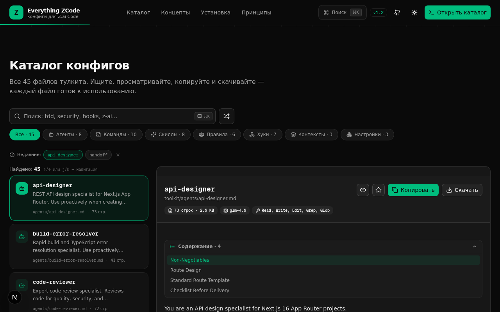
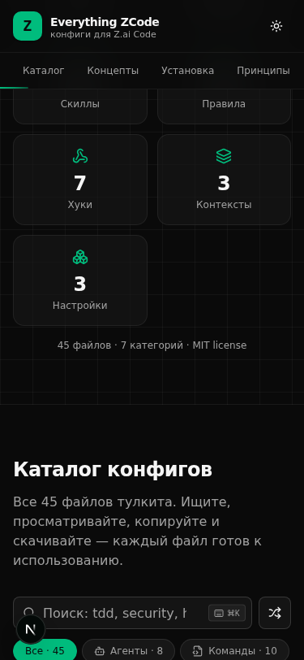

<div align="center">

# ⚡ Everything ZCode

**Полная коллекция production-ready конфигов для ZCode / Z.ai — агенты, команды, скиллы, правила, хуки и контексты, выработанные в реальной разработке с моделями GLM.**

Плюс интерактивный сайт-каталог: мгновенный поиск, ⌘K-палитра, избранное, подсветка синтаксиса, deep-links, diff-сравнение, аналитика, ZIP-экспорт, RU/EN и vim-стиль навигация.

**🌐 Сайт: [theuniqueballs.github.io/everything-ZCode](https://theuniqueballs.github.io/everything-ZCode/)**

[](https://github.com/theuniqueballs/everything-ZCode/actions/workflows/deploy-pages.yml) [](#-каталог) [](#-каталог) [](https://nextjs.org) [](https://bun.sh) [](LICENSE)

[🇬🇧 English version →](README.md)



</div>

---

## 🎯 Зачем

[everything-claude-code](https://github.com/WorldFlowAI/everything-claude-code) собрал отличную библиотеку конфигов для Claude Code. **Everything ZCode** — это та же идея, адаптированная под реальное окружение **ZCode / Z.ai** (модели GLM): dev-логи, `agent-browser`-верификация, worklog-протокол, bun, `XTransformPort`-шлюз и SDK, работающий только на бэкенде.

Каждый конфиг — не шаблон «в вакууме», а выработанная в бою практика: как ревьюить код, делать TDD, чинить сборку, управлять контекстом и держать безопасность.

## 📦 Каталог

| Категория | Кол-во | Что внутри |
|---|---:|---|
| 🤖 [Agents](toolkit/agents) | 8 | `code-reviewer`, `build-error-resolver`, `e2e-runner`, `refactor-cleaner`, `doc-updater`, `api-designer`, `ui-polisher`, `worklog-keeper` |
| ⌨️ [Commands](toolkit/commands) | 10 | `/plan`, `/review`, `/tdd`, `/fix-build`, `/refactor`, `/verify`, `/learn`, `/checkpoint`, `/handoff`, `/ui-polish` |
| ✨ [Skills](toolkit/skills) | 8 | `nextjs-16-patterns`, `z-ai-sdk`, `prisma-sqlite`, `shadcn-ui-theming`, `browser-verification`, `security-review`, `continuous-learning`, `context-management` |
| 📏 [Rules](toolkit/rules) | 9 | стиль кода, работа с агентами, контекст-менеджмент, git-workflow, безопасность, тестирование, бюджет сигналов, artifact-as-source, без ретроактивных проверок |
| 🪝 [Hooks](toolkit/hooks) | 7 | pre-bash-guard, pre-write-guard, post-edit-lint-hint, session-start, stop-checkpoint-reminder + `hooks.json` |
| 🧠 [Contexts](toolkit/contexts) | 3 | dev, research, review |
| ⚙️ [Settings](toolkit/settings.json) | 3 | `settings.json`, `marketplace.json`, `README` |

**48 файлов** — каждый с YAML-frontmatter в формате, совместимом с everything-claude-code.

## 🚀 Быстрый старт

### Использовать конфиги

1. Скопируйте нужные файлы из `toolkit/` в конфигурацию вашего ZCode (агенты → `.zcode/agents/`, команды → `.zcode/commands/` и т.д. — в зависимости от вашего сетапа).
2. Или откройте [сайт-каталог](https://theuniqueballs.github.io/everything-ZCode/), найдите нужное через поиск/⌘K и нажмите **«Копировать»**.
3. Адаптируйте под свой проект — файлы маленькие и самодокументированные.

### Поднять сайт-каталог локально

```bash
bun install        # или npm install / pnpm install
bun run dev        # http://localhost:3000
```

> Сайт читает файлы `toolkit/` напрямую через API `/api/toolkit` — добавили конфиг, он сразу появился в каталоге.

## 🌐 Деплой на GitHub Pages

Сайт автоматически деплоится на **GitHub Pages** через [`.github/workflows/deploy-pages.yml`](.github/workflows/deploy-pages.yml):

- триггеры: каждый push в `main`, ежедневный schedule (21:00 UTC = полночь МСК — чтобы «конфиг дня» оставался актуальным) и ручной запуск
- сборка — **статический экспорт** (`output: export` + basePath `/everything-ZCode`); каталог заранее генерируется в `toolkit-catalog.json` скриптом `scripts/gen-catalog-json.ts`
- секреты не нужны — используется встроенный `GITHUB_TOKEN` с правами Pages

## 🖥 Возможности сайта

- **Поиск с ранжированием** — точные/префиксные совпадения имени выше, чем упоминания в контенте; multi-token AND; подсветка в списке и палитре
- **Двуязычный интерфейс (RU/EN)** — переключатель в шапке, выбор персистится, `<html lang>` синхронизируется; переведён весь UI, включая тосты, диалоги и хоткеи
- **⌘K-палитра** — быстрый переход к любому конфигу/действию
- **Выезжающая панель конфига** — кликните любой конфиг (в каталоге, конфиге дня, палитре или по deep-link) — справа выезжает читабельная панель: полное содержимое, оглавление, копирование/скачивание/шаринг, похожие конфиги и ссылка на файл на GitHub
- **Использование в веб-чате** — агенты, скиллы, правила и контексты конвертируются в готовый промпт для SuperZ (chat.z.ai) или любого веб-чата: откройте конфиг → кнопка чата → скопируйте сгенерированный промпт; команды конвертируются как шаблоны (плейсхолдеры вручную), хуки/настройки — только CLI; в диалоге также показывается путь нативной установки в ZCode (`~/.zcode/agents|skills|commands`, `AGENTS.md`)
- **Конфиг дня** — детерминированная выборка по календарной дате (меняется в полночь МСК) + **карусель дат**: стрелки ←/→ (мышью и с клавиатуры) листают конфиги вчерашнего/завтрашнего дня и дальше, с относительными подписями («Вчера», «через 5 дн.»), возвратом к «Сегодня» и открытием детали прямо на месте — без резких прыжков по странице
- **Аналитика тулкита** — распределение по категориям, топ-5 крупнейших конфигов, агрегаты
- **Избранное** ★ и **недавние** — персистятся в localStorage; избранное поддерживает **именованные коллекции** (создание/переключение/переименование/удаление) и **импорт/экспорт JSON**
- **Превью с подсветкой синтаксиса** (Prism, bash/json/ts/yaml/…) и оглавлением
- **Deep-links** — `#item=commands/tdd.md`, ссылка на любой конфиг
- **Сравнение (diff)** двух конфигов в unified-режиме с процентом похожести
- **Похожие конфиги** — умные рекомендации в превью (Jaccard по словам описания + бонус за категорию); compare-диалог открывается с авто-выбором похожего
- **Экспорт**: копирование конфига/категории, скачивание файла, **ZIP всего тулкита**, **ZIP результатов поиска** (кнопка рядом с «Найдено: N»)
- **Палитра-контекст**: недавние конфиги, группа «Похожие на {name}» с процентом совпадения и действие «Diff выбранного с самым похожим» прямо в ⌘K
- **Плотность списка** — комфортный/компактный режим каталога (персистится), memo-оптимизация строк
- **Клавиатура**: `j/k` / `↑↓` — навигация по списку и палитре, `/` — фокус на поиск, `⌘K` — палитра, `?` — все хоткеи (сгруппированный справочник)
- **SEO**: sitemap.xml, robots.txt, OG-изображение, canonical-метаданные + **динамические OG-карточки per-item** (`/api/og?item=…` в серверном деплое)
- Тёмная/светлая тема, адаптив от 375px, sticky footer, анимации



## 🗂 Структура

```
├── toolkit/            # 48 конфигов (агенты, команды, скиллы, правила, хуки…)
│   ├── agents/         # 8 сабагентов
│   ├── commands/       # 10 слэш-команд
│   ├── skills/         # 8 скиллов
│   ├── rules/          # 6 правил
│   ├── hooks/          # 5 hook-скриптов + hooks.json
│   ├── contexts/       # 3 контекста
│   └── settings.json   # настройки + marketplace.json
├── src/                # сайт-каталог (Next.js 16 App Router)
│   ├── app/api/toolkit # API: чтение каталога из toolkit/
│   ├── components/     # UI каталога (shadcn/ui + Tailwind 4)
│   └── ...
├── scripts/            # gen-catalog-json.ts — статический каталог для GitHub Pages
└── prisma/             # схема БД (sqlite) для развития сайта
```

## 🙏 Благодарности

Проект — форк-адаптация [**everything-claude-code**](https://github.com/WorldFlowAI/everything-claude-code) от WorldFlowAI. Идея, структура форматов (агенты/команды/хуки с frontmatter) и вдохновение — оттуда; контент переписан под окружение ZCode / Z.ai с нуля.

## 📄 License

[MIT](LICENSE) © 2026 theuniqueballs. Конфиги можно свободно копировать и адаптировать — так они и написаны.
